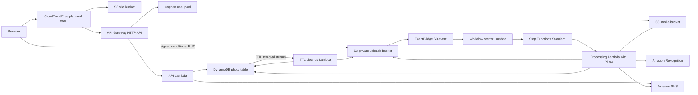

# Sunroom

Sunroom is a small photo wall built with AWS serverless services. Members upload JPEG or PNG photos, AWS checks them before publication, and approved photos appear in a public gallery. Rejected photos stay private and are removed from the upload bucket.

The interface uses a white background with blue, yellow, and coral accents. It has no external fonts, stock photo dependencies, paid third-party services, EC2 instances, containers in production, or always-running servers.

## What it does

- Creates accounts and signs users in with Amazon Cognito.
- Accepts JPEG and PNG uploads up to 2 MiB through short-lived, signed S3 PUT URLs.
- Uses a conditional S3 write so an upload URL cannot replace an object that already exists at its key.
- Starts an AWS Step Functions Standard workflow from an S3 Object Created event delivered through EventBridge.
- Checks each image with Amazon Rekognition moderation labels before making thumbnails.
- Generates small, medium, and large JPEGs with maximum dimensions of 360, 960, and 1,600 pixels.
- Stores the source privately, keeps photo state and captions in DynamoDB, and shows only approved photos in the gallery.
- Sends the owner an email notification through a per-user Amazon SNS topic after processing.
- Expires abandoned upload records with DynamoDB TTL and releases their storage reservations from a DynamoDB Streams event.
- Lets owners remove their approved, rejected, failed, and expired uploads.

## Architecture



All S3 buckets block public access. CloudFront can read the site and approved-media prefixes through Origin Access Control. The upload bucket and original photos never have a public origin. The gallery API reads only DynamoDB items with `status = APPROVED`.

## Cost guardrails

The defaults are intentionally small:

- The app reserves at most 4 GiB for originals and thumbnails. Each photo holds a 6 MiB reservation until it is removed or rejected.
- Uploads are limited to 2 MiB and at most 40 million pixels.
- The default monthly limit is 350 issued upload URLs. A separate workflow counter also caps Rekognition checks at 350 per UTC month.
- An approved image uses at most five S3 create writes: one source PUT, three thumbnail PUTs, and one private-original copy. At 350 photos, that is at most 1,750 PUT or COPY writes in the normal processing path.
- Step Functions runs one workflow per photo and has no retry loop. Even the longest error path is eight state transitions, so 350 photos use at most 2,800 transitions.
- DynamoDB uses provisioned capacity of five read units and three write units for the table and for each of its two indexes. This stays below the commonly available 25 read and 25 write unit allowance per account.
- The HTTP API has low default throttling. The public gallery response is cacheable for 60 seconds.
- CloudFront has one WAF rate rule and a 1,200 request per IP per five minute threshold.
- Set `SUNROOM_MONTHLY_LIMIT=0` to pause new uploads and moderation calls.

The deploy script associates the distribution and its WAF web ACL with the CloudFront Free plan before publishing the frontend. AWS currently lists 1 million requests and 100 GB of transfer in the Free plan, with no overage charges for CloudFront. Sustained use above the plan allowance can lead to adjusted delivery performance. The Free plan also includes 5 GB of S3 Standard storage credits. See [CloudFront flat-rate plans](https://docs.aws.amazon.com/AmazonCloudFront/latest/DeveloperGuide/flat-rate-pricing-plan.html) and [CloudFront pricing](https://aws.amazon.com/cloudfront/pricing/).

The 350-photo default is below the commonly available 1,000 Rekognition image checks per month and the 4,000 Standard Step Functions transitions per month. AWS free allowances vary by service, account age, account plan, and Region. Some allowances, including Rekognition and S3 request allowances, are time-limited. Cognito's current Lite and Essentials tiers list 10,000 monthly active users as free. Review the current [AWS Free Tier](https://aws.amazon.com/free/), [Rekognition pricing](https://aws.amazon.com/rekognition/pricing/), [Step Functions pricing](https://aws.amazon.com/step-functions/pricing/), [DynamoDB pricing](https://aws.amazon.com/dynamodb/pricing/), [API Gateway pricing](https://aws.amazon.com/api-gateway/pricing/), and [Cognito pricing](https://aws.amazon.com/cognito/pricing/) before deployment.

These limits reduce usage, but AWS cannot guarantee a zero bill for every account or every public-traffic pattern. In particular, the Rekognition allowance is time-limited and API Gateway charges are separate from the CloudFront Free plan. To keep upload processing disabled after a free allowance ends, redeploy with `SUNROOM_MONTHLY_LIMIT=0`. Check the Billing console after deployment.

## Deploy

Deploy in `us-east-1`. CloudFront-scoped WAF web ACLs must be created there. The deploy machine needs AWS CLI with `pricing-plan-manager`, AWS SAM CLI, Python 3, Docker, and credentials that can create the stack, activate the CloudFront Free plan, and upload the frontend.

```bash
SUNROOM_REGION=us-east-1 ./scripts/deploy.sh
```

Optional settings:

```bash
SUNROOM_STACK_NAME=sunroom-demo SUNROOM_MONTHLY_LIMIT=100 ./scripts/deploy.sh
SUNROOM_REGION=us-east-1 SUNROOM_MONTHLY_LIMIT=0 ./scripts/deploy.sh
```

The script builds the Pillow dependency for Lambda, deploys the SAM stack, creates or verifies a CloudFront Free plan subscription, writes the public frontend configuration, syncs the site, and invalidates the CDN cache. It stops before publishing the frontend if the Free plan is not active.

The browser URL and client ID are public configuration values. The generated `frontend/config.js` is ignored by Git. No AWS secret key is put in the frontend.

## Local preview

Copy `frontend/config.js.example` to `frontend/config.js`, then fill in `apiUrl`, `region`, and `userPoolClientId` from the deployed stack outputs. Start a local static server:

```bash
python3 -m http.server 4173 --directory frontend
```

Open `http://localhost:4173`. The browser still calls the deployed CloudFront distribution and Cognito user pool.

## Remove the deployment

```bash
SUNROOM_REGION=us-east-1 ./scripts/destroy.sh
```

The script asks you to type `DELETE`. It permanently removes stored photos. AWS schedules an active flat-rate subscription cancellation for the end of its current billing period, so the first run empties the buckets and tells you when to rerun the script to remove the remaining CloudFormation resources.

## Project files

```text
backend/api/              HTTP API routes, Cognito claims, upload tickets, gallery and deletion
backend/cleanup/          DynamoDB TTL stream cleanup for abandoned uploads
backend/start_workflow/   S3 event to Step Functions starter
backend/workflow/         Rekognition check, Pillow thumbnails, state changes, SNS notification
frontend/                 Accessible HTML, CSS, and vanilla JavaScript
statemachine/             Standard Step Functions definition
scripts/                  Deploy and cleanup commands
template.yaml             AWS SAM and CloudFormation resources
docs/                     Architecture decision and domain terms
```
