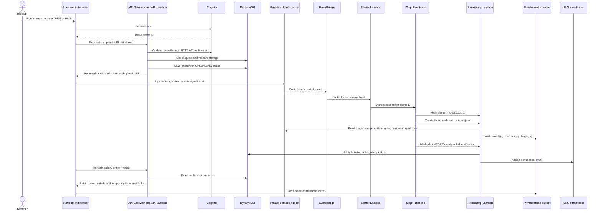
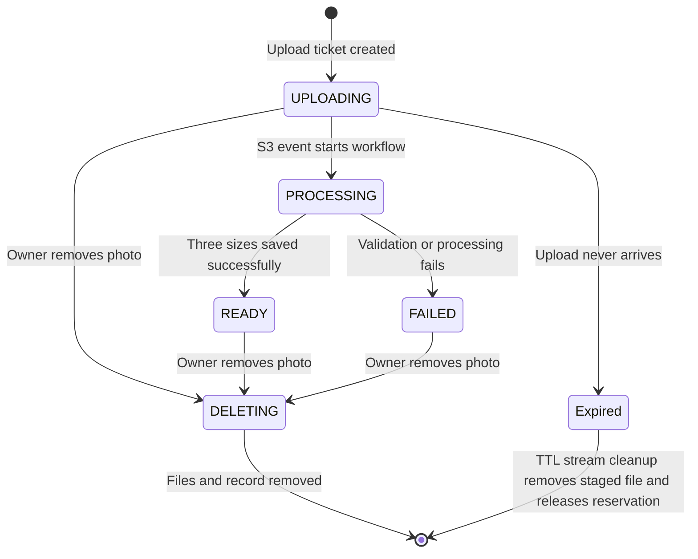

# Sunroom

Sunroom is a serverless photo-sharing app I built for a simple purpose: let people share a photo, put three useful sizes on a common photo wall, and notify the person who uploaded it when processing finishes. The app has no always-on server. AWS services handle the website, sign-in, uploads, image processing, storage, and notifications.

I built this as a personal project to learn how event-driven AWS services work together. I use AWS SAM and CloudFormation to describe and deploy the infrastructure, Python and Pillow to process images, and plain HTML, CSS, and JavaScript for the website.

## What I can do with Sunroom

- Create an account and sign in with Amazon Cognito.
- Upload JPEG or PNG photos up to 2 MiB after verifying the account email.
- Add an optional caption and display name to a shared photo.
- Let AWS create small, medium, and large JPEG thumbnails automatically.
- Browse ready thumbnails on the public photo wall and open each size in the viewer.
- View upload and processing status in My Photos and remove my own photos.
- Receive an email when processing finishes after confirming the Amazon SNS subscription.
- Keep the website and original images in private S3 buckets. The app gives browsers temporary links for generated thumbnails.

The project does not have an image moderation or approval step. A photo appears on the wall after processing succeeds. Because generated thumbnails are available to visitors with valid links, I only upload images I am comfortable sharing publicly. Original uploads remain private and are not returned by the gallery API.

## How the system fits together

```mermaid
flowchart LR
    Person[Visitor or member]
    Browser[Browser app<br/>HTML, CSS, JavaScript]
    API[API Gateway HTTP API]
    Auth[Amazon Cognito]
    ApiFn[API Lambda<br/>Python]
    Site[S3 private website bucket]
    Uploads[S3 private uploads bucket]
    EB[Amazon EventBridge]
    Starter[Workflow starter Lambda]
    SFN[AWS Step Functions<br/>Standard workflow]
    Worker[Processing Lambda<br/>Python and Pillow]
    Media[S3 private thumbnails bucket]
    DB[Amazon DynamoDB]
    SNS[Amazon SNS email topic]
    Cleanup[TTL cleanup Lambda]

    Person --> Browser
    Browser -->|HTTPS site and API requests| API
    API --> ApiFn
    API --> Auth
    ApiFn -->|Read website files| Site
    ApiFn -->|Photo records and quotas| DB
    ApiFn -->|Create short-lived upload URL| Browser
    Browser -->|Direct signed PUT| Uploads
    Uploads -->|Object created event| EB
    EB --> Starter
    Starter --> SFN
    SFN --> Worker
    Worker -->|Read staged image and save private original| Uploads
    Worker -->|Write three JPEG sizes| Media
    Worker -->|Update processing status| DB
    Worker -->|Publish completion message| SNS
    ApiFn -->|Temporary signed thumbnail URLs| Media
    DB -->|Expired upload record stream| Cleanup
    Cleanup -->|Delete abandoned staged object| Uploads
    Cleanup -->|Release storage reservation| DB
    SNS -->|Email after subscription confirmation| Person
```



The browser loads the site through API Gateway. API Gateway invokes the API Lambda, which reads static files from the private website bucket and handles API requests. Cognito manages accounts and issues tokens. API Gateway checks those tokens for routes that access or change a member's photos.

For an upload, the API checks the member's verified email, file type, file size, monthly allowance, and available storage reservation. It creates a photo record in DynamoDB and returns a short-lived, presigned S3 URL. The browser uploads directly to the private uploads bucket, so the image does not pass through the API Lambda.

S3 sends an object-created event to EventBridge. EventBridge invokes a small Lambda that starts a Step Functions execution. The state machine calls the processing Lambda to validate the image, correct its orientation, create the three sizes, save a private original, and write the generated JPEG files to the media bucket. When the workflow marks the photo READY, DynamoDB makes it visible in the gallery index. The workflow then publishes a completion message through SNS.



## Image sizes and photo visibility

The processing code uses Pillow to preserve the image's orientation, convert it to RGB, resize it within square bounds, and encode each version as an optimized JPEG at quality 82. The dimensions below are maximum bounds. The image keeps its aspect ratio, so a wide photo is not stretched into a square.

| Variant | Maximum width | Maximum height | Storage key |
| --- | ---: | ---: | --- |
| Small | 360 px | 360 px | `photos/{photoId}/small.jpg` |
| Medium | 960 px | 960 px | `photos/{photoId}/medium.jpg` |
| Large | 1,600 px | 1,600 px | `photos/{photoId}/large.jpg` |

The public wall contains only photos whose status is READY. When I open a photo, the viewer shows previews for all three generated sizes, and I can select a preview to open that size in the main view. The gallery API returns a temporary signed URL for each generated size. These URLs currently expire after six hours. Anyone who obtains a valid thumbnail URL can view that thumbnail while the URL is active. The original file is stored separately and is never exposed by the gallery.

## Photo lifecycle and cleanup



Each upload starts with a temporary DynamoDB record and an app-wide storage reservation. If the upload never arrives, the record expires and DynamoDB Streams invokes a cleanup Lambda to remove any staged object and release the reservation. If processing fails, the workflow removes partial image outputs and marks the photo FAILED. When I remove a photo, Sunroom deletes its original, staged object if present, three thumbnails, and DynamoDB record, then releases its storage reservation.

## Limits and AWS costs

The template applies limits to help keep this personal project bounded:

- The default monthly limit is 350 upload tickets. It can be lowered or set to `0` to pause new uploads.
- Each upload is limited to 2 MiB and 40 million pixels.
- The app reserves 6 MiB per photo against a total 4 GiB storage reservation ceiling.
- Generated thumbnails for one image may use up to 4 MiB in total.
- DynamoDB uses provisioned capacity of five read units and three write units for the table and each secondary index.
- API Gateway has request throttling configured in the SAM template.
- Lambda log groups retain logs for three days.
- Staged uploads have an S3 lifecycle rule that expires them after one day.

These are application limits, not a promise of free AWS usage. Free Tier eligibility and service allowances depend on the AWS account, region, current AWS offers, and actual usage. Some resources can incur charges even at low volume or if they remain deployed. I check the AWS Billing console after deployment and remove the stack when I no longer need it.

## Project layout

```text
sunroom-photo-sharing/
├── backend/
│   ├── api/              API routes, sign-in claims, uploads, gallery, and deletion
│   ├── cleanup/          Cleanup for expired upload records from DynamoDB Streams
│   ├── start_workflow/   EventBridge event handler that starts Step Functions
│   └── workflow/         Image validation, thumbnail generation, status, and email
├── docs/
│   ├── adr/              Architecture decision records
│   ├── architecture.md   Architecture and photo lifecycle notes
│   └── glossary.md       Project terminology
├── frontend/             Static HTML, CSS, and vanilla JavaScript
├── scripts/
│   ├── deploy.sh         Build, deploy, configure, and publish the site
│   └── destroy.sh        Empty project buckets and remove the stack
├── statemachine/
│   └── photo-processing.asl.json
├── template.yaml         AWS SAM and CloudFormation infrastructure
└── README.md
```

## What I need before deploying

I need an AWS account with permission to create the resources in `template.yaml`, plus these tools installed on the machine that will deploy the app:

- AWS CLI, configured with a local profile or another supported credential provider
- AWS SAM CLI
- Docker, running for the container based SAM build
- Python 3

The deploy script checks that the AWS CLI can identify the active account with STS, that Docker is running, and that a region is set. I do not put AWS access keys or secret keys in the frontend, source code, or `frontend/config.js`. The deploy script uses the local AWS credential chain. The generated `frontend/config.js` contains only the API URL, region, and public Cognito app client ID needed by the browser.

I can check the local setup with:

```bash
aws configure list
aws sts get-caller-identity --region us-east-1
sam --version
docker info
python3 --version
```

The STS command confirms which AWS identity the CLI will use. I keep credentials private and use an IAM identity with only the permissions needed to deploy and operate this stack. I never paste access keys into project files or screenshots.

## Deploying the app

From this project directory, I can deploy to `us-east-1` using the default stack name `sunroom` and the default monthly limit of 350:

```bash
cd sunroom-photo-sharing
SUNROOM_REGION=us-east-1 ./scripts/deploy.sh
```

I can choose another stack name or a smaller monthly upload limit:

```bash
SUNROOM_STACK_NAME=sunroom-demo \
SUNROOM_REGION=us-east-1 \
SUNROOM_MONTHLY_LIMIT=100 \
./scripts/deploy.sh
```

To deploy with uploads paused:

```bash
SUNROOM_REGION=us-east-1 SUNROOM_MONTHLY_LIMIT=0 ./scripts/deploy.sh
```

The script builds the Lambda packages with SAM, deploys the CloudFormation stack, reads the stack outputs, writes the browser configuration to `frontend/config.js`, and uploads the frontend to the private website bucket. It prints the HTTPS site URL when it finishes. The site is served by API Gateway and the API Lambda reading files from S3. This setup does not create a CloudFront distribution.

I can also deploy with the SAM CLI directly, but the project script does more than create the infrastructure. It also configures and publishes the frontend, so I use `scripts/deploy.sh` for the complete setup.

## Using the app

1. I open the `SiteUrl` printed by the deploy script.
2. I create an account and verify the email address Cognito sends me.
3. I sign in and choose **Share a photo**.
4. I select a JPEG or PNG no larger than 2 MiB, add an optional caption, and submit it.
5. Sunroom uploads the file and shows its processing status under **My photos**.
6. Once processing succeeds, I can find the photo on the wall and open its small, medium, and large versions.
7. I confirm the SNS subscription email if I want processing notifications. SNS email subscriptions do not receive messages until confirmed.

The app has no moderation queue. The first user to create an account is not automatically granted special administrator controls. Each signed-in member can manage their own uploads.

## Local interface preview

After deployment, the script creates `frontend/config.js` with the deployed API URL and Cognito client information. To run a simple local static server while continuing to use the deployed backend, I can run:

```bash
cd sunroom-photo-sharing
python3 -m http.server 4173 --directory frontend
```

Then I open `http://localhost:4173`. A local preview still depends on the deployed AWS API, Cognito configuration, and S3 buckets. It is not a standalone offline version.

## Troubleshooting

### The page says it cannot reach AWS

I check that the stack completed successfully in CloudFormation and that the browser is loading the right `frontend/config.js`. I confirm that the configured API URL is the `ApiUrl` or `SiteUrl` stack output, that the selected region matches the stack, and that the API Lambda has permission to read the site bucket and use DynamoDB and S3. I use the API Lambda's CloudWatch log group to inspect server-side errors. I do not put AWS credentials in browser code to work around API errors.

### The photo stays in UPLOADING or PROCESSING

I check that the direct S3 upload completed, then inspect the EventBridge rule, the starter Lambda log group, the Step Functions execution, and the processing Lambda log group. I confirm that the upload bucket's EventBridge event is enabled and that the execution can read the incoming object and write to the originals and media buckets.

### The photo is FAILED

I check that it is a readable JPEG or PNG, is no larger than 2 MiB, and does not exceed 40 million pixels. I inspect the Step Functions execution and processing Lambda logs for the failure reason. Failed photos do not appear on the public wall.

### I did not receive an email

I check the inbox used by the signed-in account and confirm the SNS subscription. I can also inspect the user's SNS topic and the Step Functions execution's Notify step. Email delivery depends on the subscription being confirmed and AWS SNS being able to deliver to that address.

### A thumbnail URL stops working

Gallery URLs are presigned and expire after six hours. Reload the photo wall or My Photos to request fresh links.

## Removing the AWS deployment

The destroy script empties the project's site, upload, and media buckets, then deletes the CloudFormation stack. This permanently deletes uploaded photos and the application data in the stack. I run it only when I am sure I no longer need the deployment:

```bash
cd sunroom-photo-sharing
SUNROOM_REGION=us-east-1 ./scripts/destroy.sh
```

The script asks me to type `DELETE` before it removes anything. If I deployed with another stack name or region, I pass those same values:

```bash
SUNROOM_STACK_NAME=sunroom-demo \
SUNROOM_REGION=us-east-1 \
./scripts/destroy.sh
```

## More project notes

- [Architecture notes](docs/architecture.md) describe request handling, the upload path, and the data lifecycle.
- [Glossary](docs/glossary.md) defines the names used for records, thumbnails, quotas, and cleanup.
- [Architecture decision record](docs/adr/0001-managed-serverless-services.md) explains the choice of managed serverless services.
# Sunroom
